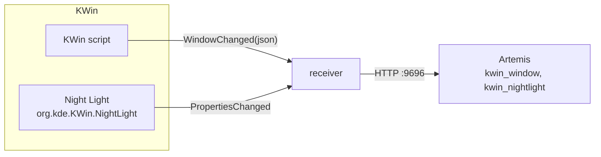

# KWin Artemis WindowBridge

Bridge from KWin 6 to Artemis RGB. The focused window and the Night Light state go out as JSON modules. Read-only: KWin keeps control of Night Light.



- `metadata.json`, `contents/code/main.js`: the KWin script. Sends a 59-field snapshot of the active window on activation. It sends it again on caption, caption-normal, minimize and fullscreen changes.
- `kwin-artemis-windowbridge-receiver.py`: owns the `org.kde.kwin.WindowBridge` D-Bus name and forwards windows to Artemis. It also watches `org.kde.KWin.NightLight` and serves the control API.

## Requirements

- KDE Plasma 6 / KWin 6
- `python3` with `dbus-python`, `PyGObject` (`gi`), `requests`
- Artemis RGB with the Web API plugin enabled, on `http://localhost:9696`

## Install

```sh
./install.sh            # --no-reload skips the KWin reload
```

Installs the KWin script to `~/.local/share/kwin/scripts/kwin-artemis-windowbridge` and the receiver to `~/.scripts/` (change with `KWB_RECEIVER_DIR`). It then writes an autostart unit, enables the script in `kwinrc` and reloads KWin.

## Artemis modules

`kwin_window` is the window snapshot: caption, resourceName/Class, pid, geometry, output, flags, desktops.

`kwin_nightlight` is the Night Light state. `currentTemperature` is KWin's animated value, so a transition arrives as 50 K steps at about 13 updates per second. Nothing needs interpolating.

Fields:

- `warmth`: 0 at `dayTemperature`, 1 at `nightTemperature`.
- `colorRed`/`colorGreen`/`colorBlue` (integer 0-255) and `gainRed`/`gainGreen`/`gainBlue` (number 0..1): KWin's white-point table at `currentTemperature`. `colorHex` is the same as a string; node inputs need the numbers.
- `mulRed`/`mulGreen`/`mulBlue` (integer 0-255): the same tint for a Multiply layer, `255 * gain^(1/tintGamma)`. The table entries are gamma-corrected and the gain lands on linear light, so using `colorRed`/`colorGreen`/`colorBlue` as a Multiply colour comes out 2.2x too warm. `tintGamma` reports the exponent (`KWB_TINT_GAMMA`, default 2.2).
- `enabled`, `running`, `active`, `inhibited`, `daylight`, `modeName`, `targetTemperature`, `dayTemperature`, `nightTemperature`, `transitionActive`, `transitionRemainingMs` and the transition timestamps.

## Notes

- KWin scripts have no timers and cannot subscribe to D-Bus properties, so the Night Light side lives in the receiver.
